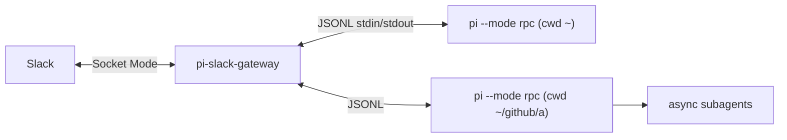

# pi-slack-gateway

Always-on Slack front end for the [Pi coding agent](https://github.com/earendil-works/pi).
Runs on your server as a single service and keeps one long-lived `pi --mode rpc`
process per *binding*:

| Slack                     | pi process                                           |
| ------------------------- | ---------------------------------------------------- |
| DM with the bot           | `cwd = ~` (configurable), one session per user       |
| channel bound to a repo   | `cwd = <repo>`, one session per channel              |

You talk only to that main agent. It runs as a *manager*: the bundled
[`prompts/manager.md`](prompts/manager.md) (appended to pi's system prompt) tells it
to delegate real work to background subagents
([pi-subagents](https://www.npmjs.com/package/pi-subagents)), review their results,
and report back. Because the pi process stays alive, turns pi starts by itself
(e.g. when a background subagent finishes) are posted to Slack too.



## Features

- **Socket Mode**: no public URL or inbound port.
- **Allowlist**: only configured Slack user IDs are served; everyone else is ignored.
- **Sessions survive restarts**: each binding's pi session file is stored and resumed
  (`--session`) when the gateway or pi restarts; pi is respawned with backoff if it crashes.
- **Steering**: messages sent while the agent is working steer the current run.
  `!later <text>` queues a follow-up instead.
- **Live status**: a single "working…" message (current tool, running subagents, latest
  note) is edited while a run is active and deleted when it finishes. 👀 marks messages
  the agent has received.
- **Markdown replies** via Slack `markdown` blocks (split at 11k chars, code fences kept
  balanced), falling back to plain text.
- **Threads**: if you write in a thread, the answer goes to that thread.
- **Attachments**: files are saved to `<stateDir>/inbox/…` and their paths given to the
  agent; images are also passed inline when the model accepts images.
- **Extension dialogs**: `select`/`confirm` become buttons; `input`/`editor` are answered
  by your next message.
- **Commands**: `!help`, `!status`, `!stop`, `!new`, `!later`, `!model`, `!thinking`,
  `!compact`, `!restart`, `!cancel`, and in channels `!bind <path>` / `!unbind`.

## Requirements

- Node.js ≥ 22.18 (runs the TypeScript sources directly; no build step)
- `pi` on `PATH`, already configured (`~/.pi/agent/settings.json`, provider auth) and
  with `pi-subagents` installed (`pi install npm:pi-subagents`) for the manager workflow

## Setup

1. **Slack app** — create it from [`deploy/slack-app-manifest.yaml`](deploy/slack-app-manifest.yaml)
   (api.slack.com/apps → *Create New App* → *From a manifest*). Then:
   - *Basic Information → App-Level Tokens*: create a token with `connections:write` → `SLACK_APP_TOKEN` (`xapp-…`)
   - *Install App*: install to the workspace → `SLACK_BOT_TOKEN` (`xoxb-…`)
   - find your member ID (profile → ⋮ → *Copy member ID*) for `allowedUsers`

2. **Install**
   ```sh
   git clone <this repo> ~/github/pi-slack-gateway && cd ~/github/pi-slack-gateway
   npm ci --omit=dev
   mkdir -p ~/.config/pi-slack-gateway
   cp deploy/config.example.json ~/.config/pi-slack-gateway/config.json   # edit it
   install -m 600 deploy/env.example ~/.config/pi-slack-gateway/env      # add the tokens
   ```

3. **Try it in the foreground**
   ```sh
   set -a; . ~/.config/pi-slack-gateway/env; set +a
   npm start
   ```
   DM the bot. To use a channel: invite the bot (`/invite @pi`), then send
   `!bind ~/github/my-repo` there (or list the channel ID in `config.json`).

4. **Run as a service** (systemd user unit, survives logout with linger)
   ```sh
   cp deploy/pi-slack-gateway.service ~/.config/systemd/user/
   systemctl --user daemon-reload
   systemctl --user enable --now pi-slack-gateway
   sudo loginctl enable-linger "$USER"
   journalctl --user -u pi-slack-gateway -f
   ```
   Check `PATH` in the unit: it must contain `node` and `pi`.

## Configuration

`~/.config/pi-slack-gateway/config.json` (override with `PI_SLACK_GATEWAY_CONFIG`):

| key | default | |
| --- | --- | --- |
| `allowedUsers` | — (required) | Slack user IDs allowed to use the bot |
| `allowedRoots` | `["~"]` | `!bind` may only target directories inside these |
| `dm` | `{ "cwd": "~" }` | binding for DMs |
| `channels` | `{}` | static bindings: `"C…": "~/path"` or `{ "cwd", "model", "thinking", "name" }` |
| `pi.command` / `pi.args` | `"pi"` / `[]` | pi executable and extra arguments for every process |
| `pi.appendSystemPrompt` | `prompts/manager.md` | file appended to pi's system prompt; `null` disables |
| `notify` | `"warnings"` | which extension notifications reach Slack: `all`, `warnings`, `none` |
| `statusDelayMs` / `statusIntervalMs` | `4000` / `5000` | when to show the live status message, and how often to edit it |
| `stateDir` | `~/.local/state/pi-slack-gateway` | `state.json` (bindings, session pointers) and the attachment inbox |

pi itself is configured as usual (`~/.pi/agent`, project `.pi/`); the gateway does not
change models or tools unless a binding sets `model`/`thinking`.

## Security notes

The agent runs with your user's permissions and pi's tools (shell included) without
interactive approval. Keep `allowedUsers` to yourself, keep `allowedRoots` tight, and
treat the Slack workspace as part of your trust boundary. Slack tokens are removed from
the environment passed to pi.

## Development

```sh
npm install
npm run check        # tsc
npm test             # node:test, uses a scripted fake pi (test/fixtures/fake-pi.ts)
node scripts/console.ts ~/some/dir   # drive one binding from the terminal with the real pi
```

Source map: `src/main.ts` (entry), `src/slack.ts` (Bolt adapter), `src/gateway.ts`
(routing, `!bind`, attachments), `src/session.ts` (one pi process per binding: runs,
status, commands, dialogs, restarts), `src/pi-rpc.ts` (JSONL RPC client),
`src/format.ts`, `src/config.ts`, `src/state.ts`.
