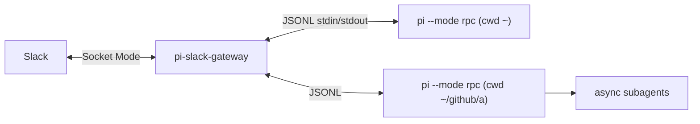

# pi-slack-gateway

Always-on Slack front end for the [Pi coding agent](https://github.com/earendil-works/pi) ([`@earendil-works/pi-coding-agent`](https://www.npmjs.com/package/@earendil-works/pi-coding-agent)).
Runs on your server as a single service and keeps one long-lived `pi --mode rpc`
process per *binding*:

| Slack                     | pi process                                           |
| ------------------------- | ---------------------------------------------------- |
| DM with the bot           | `cwd = ~` (configurable), one session per user       |
| channel bound to a repo   | `cwd = <repo>`, one session per channel              |

You talk only to that main agent. It runs as a *manager*: the bundled
[`prompts/manager.md`](prompts/manager.md) (appended to pi's system prompt) tells it
to delegate real work to background subagents
([pi-subagents](https://www.npmjs.com/package/pi-subagents)), review their results,
and report back. Because the pi process stays alive, turns pi starts by itself
(e.g. when a background subagent finishes) are posted to Slack too.



## Features

- **Socket Mode**: no public URL or inbound port.
- **Allowlist**: only configured Slack user IDs are served; everyone else is ignored.
- **Sessions survive restarts**: each binding's pi session file is stored and resumed
  (`--session`) when the gateway or pi restarts; pi is respawned with backoff if it crashes.
- **Steering**: messages sent while the agent is working steer the current run.
  `!later <text>` queues a follow-up instead.
- **Live status**: a single "working…" message (current tool, running subagents, latest
  note) is edited while a run is active and deleted when it finishes. 👀 marks messages
  the agent has received.
- **Markdown replies** via Slack `markdown` blocks (split at 11k chars, code fences kept
  balanced), falling back to plain text.
- **Threads**: if you write in a thread, the answer goes to that thread.
- **Attachments**: files are saved to `<stateDir>/inbox/…` and their paths given to the
  agent; images are also passed inline when the model accepts images.
- **Sending files**: the agent can send a local file back by putting a directive on its
  own line in its final reply (see [Sending files to Slack](#sending-files-to-slack)).
- **Extension dialogs**: `select`/`confirm` become buttons; `input`/`editor` are answered
  by your next message.
- **Commands**: `!help`, `!status`, `!stop`, `!new`, `!later`, `!model`, `!thinking`,
  `!compact`, `!restart`, `!cancel`, and in channels `!bind <path>` / `!unbind`.

## Requirements

> **Node.js ≥ 22.18 is required.** The git-clone path runs the TypeScript sources
> directly, which needs Node ≥ 22.18; the npm package ships the same floor. (The `pi`
> CLI itself currently declares Node ≥ 22.19, so in practice use 22.19 or newer.)

- Node.js ≥ 22.18
- `pi` ([`@earendil-works/pi-coding-agent`](https://www.npmjs.com/package/@earendil-works/pi-coding-agent))
  on `PATH`: `npm install -g @earendil-works/pi-coding-agent`. It must already be
  configured (`~/.pi/agent/settings.json`, provider auth) and have `pi-subagents`
  installed (`pi install npm:pi-subagents`) for the manager workflow.

## Two ways to install

| | git clone | npm package |
| --- | --- | --- |
| build step | none: runs `src/main.ts` directly (Node type stripping) | none for you: ships prebuilt `dist/*.js` |
| command | `npm start` / `node src/main.ts` | `pi-slack-gateway` (or `npx pi-slack-gateway`) |
| use it for | development, hacking on the gateway | running it as a service |

Node refuses to type-strip files under `node_modules`, which is why the npm package
contains compiled JavaScript instead of the `.ts` sources. Both paths run the same
code.

## Setup

1. **Slack app** — create it from [`deploy/slack-app-manifest.yaml`](deploy/slack-app-manifest.yaml)
   (api.slack.com/apps → *Create New App* → *From a manifest*). Then:
   - *Basic Information → App-Level Tokens*: create a token with `connections:write` → `SLACK_APP_TOKEN` (`xapp-…`)
   - *Install App*: install to the workspace → `SLACK_BOT_TOKEN` (`xoxb-…`)
   - find your member ID (profile → ⋮ → *Copy member ID*) for `allowedUsers`

2. **Install** (pick one)

   *From npm:*
   ```sh
   npm install -g pi-slack-gateway
   mkdir -p ~/.config/pi-slack-gateway
   cp "$(npm root -g)/pi-slack-gateway/deploy/config.example.json" ~/.config/pi-slack-gateway/config.json   # edit it
   install -m 600 "$(npm root -g)/pi-slack-gateway/deploy/env.example" ~/.config/pi-slack-gateway/env      # add the tokens
   ```
   The `deploy/` files (config and env examples, systemd unit, Slack manifest) live in
   `$(npm root -g)/pi-slack-gateway/deploy/`. Without a global install,
   `npx pi-slack-gateway` runs it once; fetch the `deploy/` files from the
   [repository](https://github.com/icycodes/pi-slack-gateway/tree/main/deploy).

   *From git (no build step):*
   ```sh
   git clone https://github.com/icycodes/pi-slack-gateway.git ~/github/pi-slack-gateway && cd ~/github/pi-slack-gateway
   npm ci --omit=dev
   mkdir -p ~/.config/pi-slack-gateway
   cp deploy/config.example.json ~/.config/pi-slack-gateway/config.json   # edit it
   install -m 600 deploy/env.example ~/.config/pi-slack-gateway/env      # add the tokens
   ```

3. **Try it in the foreground**
   ```sh
   set -a; . ~/.config/pi-slack-gateway/env; set +a
   pi-slack-gateway          # npm install
   npm start                 # git clone, from the checkout
   ```
   DM the bot. To use a channel: invite the bot (`/invite @pi`), then send
   `!bind ~/github/my-repo` there (or list the channel ID in `config.json`).

4. **Run as a service** (systemd user unit, survives logout with linger)
   ```sh
   cp deploy/pi-slack-gateway.service ~/.config/systemd/user/   # npm install: "$(npm root -g)/pi-slack-gateway/deploy/pi-slack-gateway.service"
   systemctl --user daemon-reload
   systemctl --user enable --now pi-slack-gateway
   sudo loginctl enable-linger "$USER"
   journalctl --user -u pi-slack-gateway -f
   ```
   Check `PATH` in the unit: it must contain `node` and `pi`. The unit is written for the
   git checkout (`WorkingDirectory=…/pi-slack-gateway`, `ExecStart=/usr/bin/env node src/main.ts`);
   for an npm install, remove `WorkingDirectory` and set `ExecStart=/usr/bin/env pi-slack-gateway`
   (with the global npm `bin` directory on `PATH`).

## Configuration

`~/.config/pi-slack-gateway/config.json` (override with `PI_SLACK_GATEWAY_CONFIG`):

| key | default | |
| --- | --- | --- |
| `allowedUsers` | — (required) | Slack user IDs allowed to use the bot |
| `allowedRoots` | `["~"]` | `!bind` may only target directories inside these |
| `dm` | `{ "cwd": "~" }` | binding for DMs (same options as a channel binding object) |
| `channels` | `{}` | static bindings: `"C…": "~/path"` or `{ "cwd", "model", "thinking", "name", "tools" }`; `tools` defaults to `subagent,read,grep,find,ls` |
| `pi.command` / `pi.args` | `"pi"` / `[]` | pi executable and extra arguments for every process |
| `pi.appendSystemPrompt` | `prompts/manager.md` | file appended to pi's system prompt; `null` disables |
| `notify` | `"warnings"` | which extension notifications reach Slack: `all`, `warnings`, `none` |
| `statusDelayMs` / `statusIntervalMs` | `4000` / `5000` | when to show the live status message, and how often to edit it |
| `stateDir` | `~/.local/state/pi-slack-gateway` | `state.json` (bindings, session pointers) and the attachment inbox |

pi itself is configured as usual (`~/.pi/agent`, project `.pi/`); the gateway does not
change models unless a binding sets `model`/`thinking`. It does restrict tools by default
for config bindings (below).

### A binding's tools (restricted by default)

Bindings from `config.json` (`dm` and static `channels`, including the plain
`"C…": "~/path"` form) run with this tool allowlist unless they set `tools`:

```
subagent,read,grep,find,ls
```

Why: a chat binding should delegate, not work. While a turn runs, the operator's Slack
thread is held; with `bash` a single call can block it for up to 150 s (pi's default
bash timeout), and the agent chains calls. With this allowlist the agent can launch
subagents and verify their work by reading files and diffs, but it cannot run tests or
builds or edit files — that is the worker's job, reported back as evidence. Subagents
are unaffected: they run in their own pi process with their own (full) tool set. The
default [`prompts/manager.md`](prompts/manager.md) assumes this restriction.

A binding's `tools` value:

| `tools` | pi is started with |
|---|---|
| absent | `--tools subagent,read,grep,find,ls` (the default) |
| `"read,grep"` (any non-empty string) | `--tools read,grep`, passed verbatim; replaces pi's whole tool selection |
| `null` or `""` | no `--tools` flag: pi's default tools (`bash`, `edit`, `write`, …) |

```json
"C0123456789": { "cwd": "~/github/some-repo" },
"C0987654321": { "cwd": "~/github/other-repo", "tools": null }
```

Bindings created with `!bind` have no options and are not affected: they keep pi's
default tools (no `--tools` flag).

> **Breaking change:** earlier versions passed no `--tools` unless a binding set it, so
> `dm` and channel bindings had `bash`/`edit`/`write`. If a binding relied on working
> directly, add `"tools": null` to it in `config.json` and restart the gateway.

## Sending files to Slack

pi has no RPC method for files, so the gateway looks for a directive in the agent's
final reply. A line of the form

```
[send-file: /path/to/file.png]
[send-file: /path/to/file.png] Optional caption
```

is removed from the posted text and the file is uploaded to the same channel/thread as
the reply. Details:

- The directive must start the line (leading whitespace is fine) and the path must be
  closed by `]`. The path may contain spaces and may be wrapped in backticks. Anything
  after `]` is the caption. Lines inside fenced code blocks are ignored.
- `~/…` is expanded; relative paths resolve against the binding's directory (the cwd
  pi runs in). Only existing regular files up to 100 MB are sent.
- Several directives in one reply are handled in order. If a reply contains only
  directives, no empty text message is posted.
- If a file is missing, is a directory, is too large, or the upload fails, the reply
  text is still posted and a `:warning: could not send <path>: <reason>` notice follows.
- Requires the `files:write` bot scope. It is in the manifest, but an app created from
  an older manifest must add the scope and be **reinstalled** to the workspace
  (*Install App → Reinstall*); until then uploads fail with `missing_scope`.

The agent only uses this if it knows about it. The default appended system prompt
([`prompts/manager.md`](prompts/manager.md)) describes the directive, so default installs
work out of the box. If you set `pi.appendSystemPrompt` to `null` or to your own file,
the model is not told; add the directive syntax to your prompt (or `AGENTS.md`) yourself.
Example with [agent-browser](https://github.com/vercel-labs/agent-browser):

> *you:* screenshot http://localhost:3000/login and send it to me
>
> *agent* runs `agent-browser open http://localhost:3000/login` and
> `agent-browser screenshot /tmp/login.png`, then replies:
> ```
> Here is the login page.
> [send-file: /tmp/login.png] localhost:3000/login
> ```

Slack shows "Here is the login page." followed by the uploaded image with its caption.

## Security notes

The agent runs with your user's permissions and pi's tools (shell included) without
interactive approval. Keep `allowedUsers` to yourself, keep `allowedRoots` tight, and
treat the Slack workspace as part of your trust boundary. Slack tokens are removed from
the environment passed to pi. The `[send-file: …]` directive can upload any regular
file your user can read, so a reply that names a secret file would post it to Slack.

## Development

```sh
npm install
npm run check        # tsc (type-check only)
npm test             # node:test, uses a scripted fake pi (test/fixtures/fake-pi.ts)
node scripts/console.ts ~/some/dir   # drive one binding from the terminal with the real pi
npm run build        # compile src/ to dist/ (only needed for publishing; wipes dist/ first)
npm run pack:check   # build, then dry-run `npm pack` to list the tarball contents
```

Tests and `npm start` run the TypeScript sources and never need `dist/`. The published
package contains `bin/` (a small plain-JS launcher that checks the Node version before
loading the app), `dist/`, `prompts/` and `deploy/`.

Source map: `src/main.ts` (entry), `src/slack.ts` (Bolt adapter), `src/gateway.ts`
(routing, `!bind`, attachments), `src/session.ts` (one pi process per binding: runs,
status, commands, dialogs, restarts), `src/pi-rpc.ts` (JSONL RPC client),
`src/format.ts`, `src/config.ts`, `src/state.ts`.
